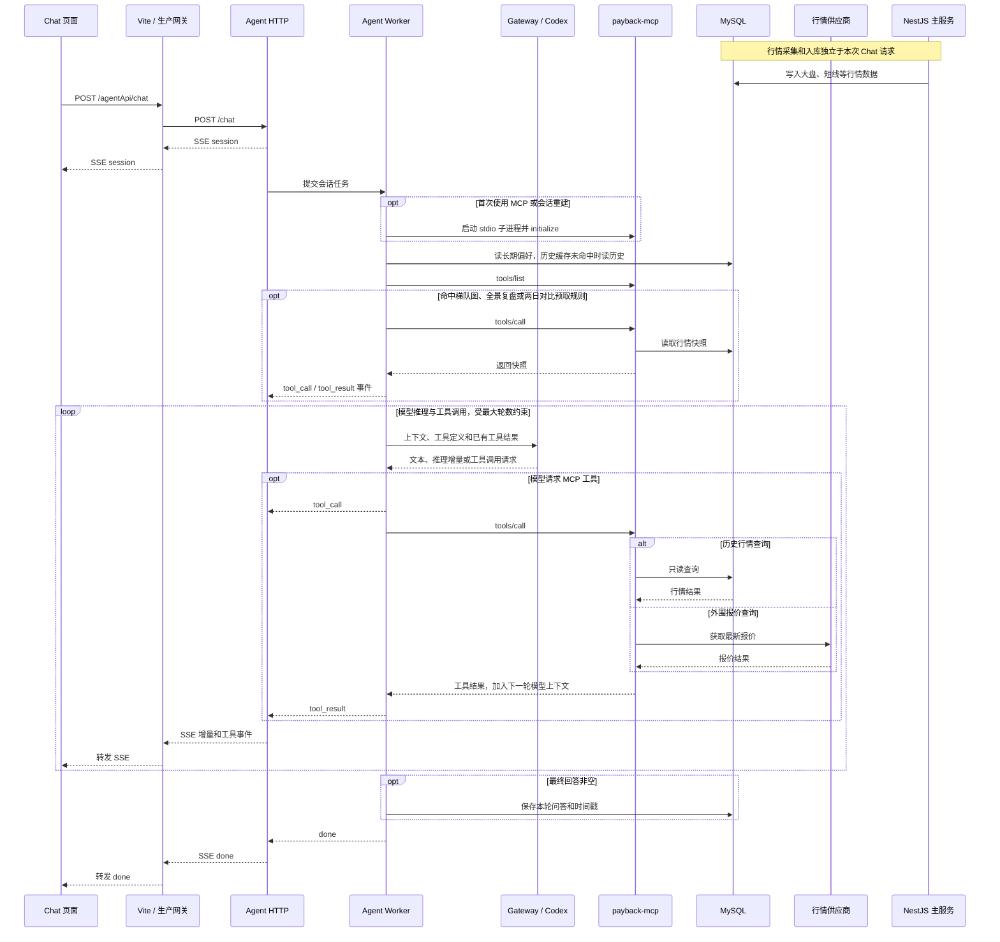

# Chat 调用链与交互时序

> 最后验证：2026-11-20

本文按工作区源码梳理 `/chat` 页面、`POST /agentApi/chat` 和 Agent、MCP、NestJS 主服务之间的调用。线上网关与运行行为尚未实测。

## 页面与 HTTP 入口

1. `/chat` 路由加载 Chat 页面。页面挂载后分页加载会话列表，选中会话时按需加载消息。发送时 `onSend()` 插入用户消息，`runTurn()` 创建助手消息占位和 `AbortController`。 [路由](../../packages/client/src/router/index.ts#L72) · [Chat 页面](../../packages/client/src/views/chat/index.vue#L519)
2. `chatWithAgent()` 使用 `fetch` 提交 `{ message, session_id?, model? }`。开发环境通过 Vite 去掉 `/agentApi` 前缀，转发到 Agent 的 `POST /chat`，目标由 `VITE_BASE_API_AGENT` 配置，默认 `http://localhost:8300`。 [前端 API](../../packages/client/src/api/agent.ts#L71) · [Vite 代理](../../packages/client/vite.config.ts#L52)
3. Agent 校验消息、会话 ID 和模型。非法请求返回 HTTP 400 JSON。合法请求返回 `text/event-stream`，首帧为 `session`，之后提交任务并转发 Worker 事件。新会话 ID 由 Agent 生成。 [HTTP 入口](../../../payback-agent/src/payback_agent/serve.py#L357)

## 请求时序

## 服务边界

- **Agent 与模型**。请求级 `model` 可覆盖服务默认值，默认由 `AGENT_LLM_BACKEND` 控制，缺省为 `gateway`。Gateway 调用 `/chat/completions`，Codex 由 Agent 启动 `codex exec` 并读取结构化结果。模型提出工具请求，Agent 执行并把结果追加到模型上下文。 [模型选择](../../../payback-agent/src/payback_agent/config.py#L98) · [模型循环](../../../payback-agent/src/payback_agent/loop.py#L228)
- **Agent 与 MCP**。单个 Worker 独占并复用 MCP 的 stdio 会话，串行处理 Chat、每日复盘生成和双图任务。MCP 的行情连接用于只读查询，外围报价工具请求行情供应商。启用研究运行时后，`research_*` 由 Agent 内部的 `ResearchSource` 分派。 [任务队列](../../../payback-agent/src/payback_agent/serve.py#L88) · [工具分派](../../../payback-agent/src/payback_agent/tools_source.py#L108) · [MCP 工具注册](../../../payback-mcp/src/payback_mcp/server.py#L79)
- **NestJS 与 Agent**。Chat 通过网关直达 Agent。NestJS 的行情采集写入 MySQL，供 MCP 查询。双图推送另有 `NestJS → POST /review-charts/{date} → Agent Worker → MCP` 链路，与 Chat 共用 Agent 队列。 [行情写入](../../packages/server/src/pay-back/service/market.service.ts#L48) · [双图请求](../../packages/server/src/pay-back/service/reviewCharts.service.ts#L18) · [双图队列](../../../payback-agent/src/payback_agent/serve.py#L112)

## 流式状态与排查入口

| 事件或现象 | 行为 |
|---|---|
| `session` | 页面记录会话 ID，后续提问携带此 ID。 |
| `delta`、`reasoning_delta` | 前端缓冲正文和推理增量，再合并到当前助手消息。 |
| `tool_call`、`tool_result` | 更新工具执行状态。原始工具结果保留在 Agent 侧。 |
| `done` | 非空问答先保存到 MySQL，再发送最终正文和时间戳。完整模型消息栈留在 Agent 侧。 |
| `error`、HTTP 或网络错误 | 页面展示错误并保留本地快照。SSE 业务错误通过事件传递，HTTP 或网络错误由 `fetch` 调用链处理。 |
| 点击停止或离开页面 | 浏览器取消请求。尚在排队的任务会在 Worker 发现接收端已关闭时跳过。在途任务通常到下一次发送事件时才感知断开。 |
| 开发正常、部署后返回 HTML 或 404，或流式输出积压 | 检查生产网关的 `/agentApi/` 转发、前缀移除、SSE 禁缓冲和读取超时。仓库自带的客户端 Nginx 配置缺少该转发。 |

[前端事件处理](../../packages/client/src/views/chat/index.vue#L561) · [落盘与事件裁剪](../../../payback-agent/src/payback_agent/serve.py#L258) · [部署配置](../04-技术方案/项目部署操作手册.md#L158)

## 相关文档

- [三项目协作与 AI 复盘](三项目协作与AI复盘.md)
- [Agent 线上接入 Codex 方案](../04-技术方案/Agent线上接入Codex方案.md)
- [环境配置](../04-技术方案/环境配置.md)
