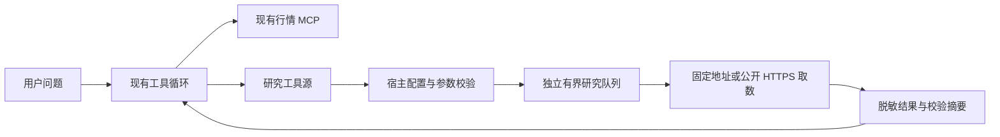

# Agent 受控研究与临时工具方案

> 最后验证：2026-11-19
> 状态：取数及隔离计算续批已实现；本页保留首批审查依据，当前执行/恢复契约见[续批说明](Agent隔离计算与任务恢复.md)。未部署或验证真实供应商。

## 目标与范围

现有 Agent 只能调用已注册 MCP 工具。遇到跨日期全市场统计、陌生数据源或特殊文件计算时，应识别缺口、发现来源、验证接口并执行受控研究，而不是直接要求用户准备全部数据。

A 股优先 aiwencai，已按本项目后端实际使用的 iwencai 地址/协议及 createV 接入，详见[爱问财接入](Agent爱问财接入.md)。不混用其他供应商的 OpenAPI；没有已知协议、权限或足够覆盖时明确返回缺口，不猜端点或字段。

首批交付：可选启用的研究工具源、数据源目录、公开 HTTPS 文档读取、Brave 搜索适配器、管理员预登记 API 操作、独立有界执行队列、任务状态/取消/结果读取、脱敏证据文件与离线回归。

续批已补充 Python 隔离计算、跨 MCP 重连、重启证据查询、显式恢复与待审工具导出。爱问财首屏已真实验证，现有分页上游业务错误被显式标记为名单不完整；语义/复权仍需核对。正式工具须人工评审后发布，不自动安装依赖/MCP、开放写操作或修改生产代码。

## 总体设计

模型只提交意图与请求参数。来源、端点、HTTP 方法、字段类型、凭据绑定及执行预算由宿主配置和代码控制，网页/模型都不能修改授权。

公开文档读取不携带 Cookie、Authorization 或供应商凭据；带凭据 API 请求仅允许预登记的固定 HTTPS URL，不跟随重定向。连接使用已校验公网 IP，TLS 仍按原域名校验证书，不使用系统代理。

## 能力契约

| 工具 | 作用 | 边界 |
|---|---|---|
| research_sources | 查看已登记来源、操作和参数 | 不暴露凭据或密钥环境变量值 |
| research_start | 提交 search/fetch/request/python 任务 | 不支持模型指定 URL 的带凭据请求；Python 仅固定隔离容器 |
| research_status | 查看任务状态和摘要 | 任务 ID 为随机标识；仅可信单用户入口使用 |
| research_result | 分段读取脱敏结果 | 限制每段大小；完整原始响应不进入模型上下文 |
| research_cancel | 取消排队或运行中任务 | 不再启动后续请求；在途请求按网络超时结束，不能撤回已经发送的请求 |
| research_resume | 显式恢复失败/取消/中断任务 | 创建新 ID，重查权限，可能重新计费，不自动重发 |
| research_export_tool | 导出成功 Python 的待审草案 | 不自动注册、启用或发布 |

状态为 queued → running → succeeded / failed / cancelled，进程中断恢复为 interrupted；运行中取消优先于结果提交。返回零条数据与错误是不同状态，通用取数/代码成功不宣称业务统计已验证。

## 审查结论与修正

| 问题 | 最小修正 | 验收重点 |
|---|---|---|
| HTTP 执行器成为带凭据代理 | 端点、操作、参数和凭据均由宿主绑定 | 重定向、私网、DNS 地址变化、未知参数被拒绝 |
| 宿主执行生成代码 | 续批仅固定无网络容器，先验证实际隔离状态 | 宿主回退、任意挂载和安装均被拒绝 |
| 模型自证统计正确 | 分离结构校验与领域口径验证 | 分页、日期、复权、股票池及真实零结果 |
| aiwencai 被当作万能来源 | 先验证文档和解析条件，失败分类后才回退 | 不悄悄改变问题口径，不以非空结果作为成功标准 |
| 长任务阻塞聊天与日报 | 网络研究在独立线程队列执行，不共享 MCP | 提交立即返回，队列有界，正常聊天不等待研究完成 |
| 缓存继承旧权限 | 每次执行重新校验配置和参数 | 首批不复用适配器和数据缓存 |
| 无法追溯或日志泄密 | 保存任务、时点、状态、来源、摘要与脱敏产物 | 不保存请求头密钥；设置清理及结果上限 |
| 多用户越权 | 功能默认关闭，明确单用户边界 | 公网/多租户开放前补认证、所有权和出站数据控制 |

## 数据正确性

通用 HTTP 成功只证明取得响应，不证明数据完整、条件正确或统计成立。任务结果统一带“未经领域口径校验”的提示。

爱问财适配返回实际解析条件、上游总数、名单去重和分页覆盖；仍须核对行情时点、基准日期、复权与排除项。全市场独立比较还需区分可比股票和新上市/缺失数据，满足分组数与分母一致。不将上游报告数或局部名单冒充独立复核结论。

失败区分：未配置、参数无效、权限/供应商错误、网络失败、响应过大/不支持、队列满、任务取消。首批不自动重试或切换来源，避免重复付费或语义漂移。

## 生命周期与权限

- 研究能力由 AGENT_RESEARCH_ENABLED 显式启用；不改变 Codex CLI 的只读限制。
- 使用独立研究目录，任务与结果按随机 ID 组织；原子写入，拒绝路径穿越。
- 内存活动任务与磁盘结果均设上限及保留期限；服务关闭取消排队任务，在途网络请求超时后退出。
- 当前 AgentService 独立持有研究 runtime；MCP 重连保留研究任务，重启后恢复证据并把未完成任务标记中断，不自动重发。请求明文落盘供显式恢复，见续批说明中的 ACL、单写锁和留存限制。
- API 配置是管理员可信资产；不要允许模型通过文件写入或网页导入覆盖它。
- 当前 HTTP 服务缺少内建用户认证；启用功能时仅限可信本机或已保护网关，不构成多租户隔离。

## 行业对比与决策

按需发现工具、代码内聚合数据并返回摘要，与 Anthropic 的工具搜索/程序化调用方向一致。任意程序执行与调用宿主限定方法采用不同权限，与 Cloudflare Code Mode/Sandbox 的区分一致。长期任务恢复参考 LangGraph 检查点，但首批不引入框架或任务恢复承诺。

保留单 Agent 和现有 MCP，不建设通用插件市场。临时请求计划不等于正式工具；正式工具需版本化、固定样本及人工代码评审后按正常开发流程交付。

## 首批实现与验证

实现位于同级 `payback-agent/src/payback_agent/`：`research_http.py` 为固定公网 IP/TLS/绝对网络预算，`research.py` 为来源策略与搜索/文档/API 适配，`research_jobs.py` 为有界任务与证据，`tools_source.py` 为可选工具聚合。功能默认关闭，未修改本机真实配置或重启 Agent。

独立复查补齐：慢速响应头/正文绝对超时、Content-Length 提前断流校验、失败产物清理不终止 worker、声明字符集严格解码、来源配置失败不阻断独立公开读取/搜索、未知参数约束拒绝。取数结果带 UTC 完成时间和输入/结果摘要。

2026-11-19 全量 Agent 回归为 281 通过、5 跳过；包含真实工具循环与假网络的端到端测试。公开 HTTPS 读取 Python 官网 robots.txt 成功，example.com 重试时有网络超时；没有调用付费 API、验证 aiwencai、运行生成代码或部署服务。

## 来源与相关文档

- [高级工具使用](https://www.anthropic.com/research/advanced-tool-use)
- [MCP 代码执行](https://www.anthropic.com/research/code-execution-with-mcp)
- [Cloudflare Sandbox](https://developers.cloudflare.com/agents/tools/sandbox/)
- [OWASP SSRF 防护](https://cheatsheetseries.owasp.org/cheatsheets/Server_Side_Request_Forgery_Prevention_Cheat_Sheet.html)
- [OWASP 过度代理权限](https://genai.owasp.org/llmrisk/llm062025-excessive-agency/)
- [Agent 评估](https://www.anthropic.com/research/demystifying-evals-for-ai-agents)
- [Brave 搜索接口](https://api-dashboard.search.brave.com/api-reference/web/search/get)
- [受控研究回归用例](../07-测试用例/受控研究回归用例.md)
- [实施计划](../superpowers/plans/2026-11-19-controlled-research.md)
- [三项目协作与 AI 复盘](../03-架构设计/三项目协作与AI复盘.md)
