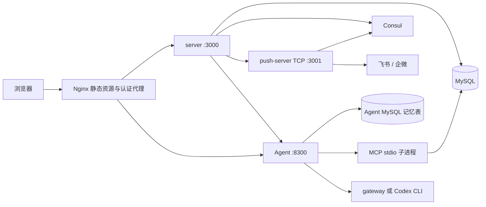

# 项目部署操作手册

> 最后验证：2026-11-12

本文汇总 payback、payback-agent、payback-mcp 的部署依赖、发布顺序、验收与回滚。依据当前源码、配置和本机重启记录整理；Linux/PM2/Nginx 部分为待目标环境验证的部署建议，不代表已完成线上部署。沿用现有知识库目录，不新增部署平台。

## 1. 部署单元与依赖

| 单元 | 作用 | 端口及依赖 | 部署方式 |
|---|---|---|---|
| client | 看盘、聊天、复盘页面 | 开发 8888；生产由 Nginx 提供静态文件 | `packages/client/dist` |
| server | 行情采集、JWT API、定时任务 | HTTP 3000；MySQL、Consul、push-server；双图依赖 Agent | PM2 单实例 `payBack` |
| push-server | 新闻、企微/飞书、双图转换推送 | TCP 3001，非 HTTP；Consul、机器人、中文字体 | PM2 单实例 `pushServer` |
| payback-agent | HTTP/SSE、模型循环、会话记忆、复盘归档 | 默认 127.0.0.1:8300；MySQL 记忆库、uv、MCP、模型后端 | 建议 PM2 管理单个 Python 进程 |
| payback-mcp | 只读行情查询与原始数据统计 | stdio，无监听端口；MySQL、可选行情供应商 | Agent 按需拉起，不单独部署 HTTP 服务 |
| MySQL | 行情和 Agent 会话/长期偏好 | 3306；代码保持 MySQL 5.7 兼容约束 | 独立持久化服务，发布应用时不重置数据 |
| Consul | Node 服务注册发现 | 本机 HTTP 18500；现有容器内为 8500 | 先启动，再注册 push-server |
| webhook-server | Gitee 事件触发拉取代码 | HTTP 3002；Consul、push-server | 可选，不是三仓统一发布控制器 |

`wxPusher` 为未接入主链路的原型，`core` 为构建时共享库，均不作为常驻业务服务启动。



**启动顺序**：MySQL、Consul → push-server → Agent → server → client/Nginx。MCP 随 Agent 的实际工具请求启动；Agent `/healthz` 成功不证明 MCP、数据库和模型已全部可用。server 的 Consul 发现没有吞掉异常，不能假定缺少 Consul 仅告警而不影响启动。

server 会在 3000 被占用时尝试换端口，但服务注册仍读取 `APP_PORT`；生产必须保证预定端口可用并检查实际监听。push-server 当前固定监听 3001，修改 `APP_PORT` 只改变注册参数，不能改变监听端口。

## 2. 目录、版本与运行账户

建议 Linux 目录如下，以下命令均以 Bash 为例；由运维预先创建目录并授予服务账户权限。

```text
/srv/payback-all/
├── payback/
├── payback-agent/
└── payback-mcp/
```

安装 Node >= 22、项目锁文件适用的 pnpm、Python >= 3.11、uv、PM2 和 Nginx。抓取依赖须保持与项目 Playwright 1.35 / Firefox 约定兼容；字体及 resvg 原生包在目标系统验收，不直接复制另一操作系统的 node_modules 或 .venv。

| 仓库 | 当前发布来源 | 2026-11-12 已推送版本 |
|---|---|---|
| payback | `origin/master` | `2935e2c` |
| payback-agent | `origin/main` | `8973108` |
| payback-mcp | `origin/feat/m1` | `f112424` |

MCP 远端 `main` 当时只有独立初始化提交，不能用它替代 `feat/m1`。此表是可追溯版本快照，后续发布必须记录三个实际 SHA；不要仅凭分支名认定已部署相同版本。

首次取代码可使用：

```bash
export DEPLOY_ROOT=/srv/payback-all
git clone --branch master https://github.com/zhangyingxuan/payback.git "$DEPLOY_ROOT/payback"
git clone --branch main https://github.com/zhangyingxuan/payback-agent.git "$DEPLOY_ROOT/payback-agent"
git clone --branch feat/m1 https://github.com/zhangyingxuan/payback-mcp.git "$DEPLOY_ROOT/payback-mcp"
```

已有部署目录先确认无未提交业务修改，再获取审核过的发布 SHA。由同一服务账户安装依赖、运行 uv/MCP 和管理 PM2；Codex 模式的认证也必须属于该账户，不能依赖交互登录用户的 PATH 或凭据。

## 3. 配置与持久化

所有配置仅列键名，实际凭据通过主机配置或密钥注入维护。仓库仍有已跟踪的历史 `.env.*`，不能因 Git 跟踪就认为其中值适合生产；发布前比对键名，不用仓库文件覆盖服务器密钥。

| 组件 | 配置位置 / 关键键 | 发布检查 |
|---|---|---|
| server | `packages/server/.env.prod`；`DDD_HOST/PORT/USER/PD/NAME`、`CONSUL_HOST/PORT`、`APP_NAME/HOST/PORT`、`TASK_RETRY_TIME`、`PAYBACK_AGENT_URL` | `DDD_PD` 为现有 base64 格式，不是加密；`DB_SYNCHRONIZE=false` 防止应用重启自动改写存量表结构 |
| push-server | `packages/push-server/.env.prod`；`CONSUL_HOST/PORT`、`APP_NAME/HOST/PORT`、`FEISHU_APP_ID/SECRET` | 机器人 webhook/签名和目标群还需核对 `PushService` 既有配置，不能仅配置上传应用凭据 |
| client | 构建模式对应 `.env.production`；`VITE_*`、`VITE_BASE_API_AGENT` | Vite 代理只对开发服务生效；浏览器可见的构建变量不得包含密钥 |
| Agent | `payback-agent/.env` | 环境变量优先于文件；`AGENT_MEMORY_MYSQL_HOST/PORT/USER/PASSWORD/NAME` 为独立可写记忆账号 |
| Agent 模型 | `AGENT_LLM_BACKEND` | gateway：`AGENT_LLM_BASE_URL/API_KEY/MODEL`；codex：`AGENT_CODEX_COMMAND/MODEL`，需服务账户已认证 |
| Agent → MCP | `PAYBACK_MCP_DIR`、`PAYBACK_MCP_COMMAND` | 默认同级 MCP 目录，命令默认 uv；服务账户 PATH 必须找到 uv |
| MCP | `payback-mcp/.env`；`AGENT_MYSQL_HOST/PORT/USER/PASSWORD/NAME` | 行情账号仅 SELECT；`BUILD_MYSQL_USER/PASSWORD` 仅用于独立离线构建，不供在线工具写库 |
| 可选行情 | MCP 的 `FUYAO_API_KEY`、`TWELVE_DATA_API_KEY` | 缺少凭据或套餐限制不能伪装为实时行情；不阻断不依赖该供应商的功能 |

Node 的 `NODE_ENV` 必须显式使用 `dev` 或 `prod`，两侧注册/查找的 `payBack_pushServer_<env>` 必须一致。同主机 Consul 可访问 127.0.0.1:18500；容器内的 127.0.0.1 只指本容器，需改为实际网络地址。`APP_HOST` 必须是消费方可达的地址。

持久化与备份至少覆盖：行情库、Agent 的三张 `agent_*` 记忆表、`payback-agent/data/daily_reports/`、各服务配置及凭据。Agent 历史已在 MySQL 持久化，内存 LRU 不是唯一存储；报告目录是文件归档，换目录/容器需迁移或挂载。数据库写入账号需要目标库 CREATE 及记忆表 CRUD 权限。旧 SQLite 迁移只按 Agent README 的专门流程进行，不作为每次发布步骤。

## 4. 构建与离线验证

在部署前或 CI 构建环境执行，不使用 `npm install` 替换工作区 pnpm；Python 保留 uv.lock。需要构建器和测试依赖，不能在构建前裁掉开发依赖。

```bash
export DEPLOY_ROOT=/srv/payback-all
cd "$DEPLOY_ROOT/payback"
pnpm install --frozen-lockfile
pnpm exec lerna run build --scope=pay-back-client --scope=pay-back-server --scope=push-server --include-dependencies
pnpm --filter pay-back-core test
node --test packages/client/tests/*.test.cjs
pnpm --filter pay-back-server test -- --runInBand
pnpm --filter push-server test -- --runInBand

cd "$DEPLOY_ROOT/payback-mcp"
uv sync --frozen
uv run --frozen pytest -q
cd "$DEPLOY_ROOT/payback-agent"
uv sync --frozen
uv run --frozen pytest -q
```

Lerna/Nx 保证 core 先构建；server 消费 core 的 CJS 构建产物，client 通过源码别名取用。测试均使用假网络/假模型，不能作为真实机器人投递成功的证明。2026-11-12 验证为 530 通过、5 跳过，四个 Node 包构建成功；core 构建仍输出既有 ESLint 解析配置错误，退出码 0 不代表 lint 干净。

## 5. 推荐的单机生产进程管理

以下为目标 Linux 主机的建议命令，未在本机 Windows 直接执行。先确认 MySQL 和生产 Consul 可达；现有 Consul Compose/本机 dev agent 只能作为联调配置，不等同于生产持久化和访问控制方案。

```bash
export DEPLOY_ROOT=/srv/payback-all
export TZ=Asia/Shanghai
export DB_SYNCHRONIZE=false

cd "$DEPLOY_ROOT/payback/packages/push-server"
pm2 start ecosystem.config.js --env prod
# 确认 Consul 已出现 payBack_pushServer_prod，且 TCP 3001 可达后再启动 server。

cd "$DEPLOY_ROOT/payback-agent"
pm2 start "$DEPLOY_ROOT/payback-agent/.venv/bin/python" \
  --name payback-agent --interpreter none --cwd "$DEPLOY_ROOT/payback-agent" \
  -- -m payback_agent.cli --serve --host 127.0.0.1 --port 8300

cd "$DEPLOY_ROOT/payback/packages/server"
pm2 start ecosystem.config.js --env prod
pm2 status
```

PM2 两个 Node ecosystem 的进程名分别为 `pushServer`、`payBack`，`script` 为 `dist/main.js`，启动目录必须是各自包目录。不要把 server 的 `pnpm start:prod` 当作无监视生产模式，它目前仍执行 `nest start --watch`。完成验收后再 `pm2 save`，由运维为服务账户配置开机恢复和日志轮转。

更新已有进程使用 `pm2 restart pushServer --update-env`、`pm2 restart payback-agent --update-env`、`pm2 restart payBack --update-env`，按依赖顺序检查后再继续。首次部署用 start，后续不要重复 start 产生多个采集进程。当前任务防重入、双图回执去重均在进程内；多实例会重复采集、调度和推送，第一版按单实例运行。

## 6. Nginx 与访问边界

静态根目录指向实际发布的 `packages/client/dist`。保留现有 `/tonghuashun`、`/thsNews`、`/thsDq` 供应商代理；下面只展示合并到既有 `server` 块的两个业务 location，不是可直接替换整份配置的文件。

```nginx
location /blowsysun/ {
    proxy_pass http://127.0.0.1:3000;
    proxy_set_header Host $host;
    proxy_set_header X-Real-IP $remote_addr;
    proxy_set_header X-Forwarded-For $proxy_add_x_forwarded_for;
    proxy_set_header X-Forwarded-Proto $scheme;
}

location /agentApi/ {
    # 末尾斜杠移除 /agentApi/ 前缀，与开发环境 Vite 代理一致。
    proxy_pass http://127.0.0.1:8300/;
    proxy_http_version 1.1;
    proxy_set_header Authorization $http_authorization;
    proxy_set_header Host $host;
    proxy_set_header X-Forwarded-For $proxy_add_x_forwarded_for;
    proxy_set_header X-Forwarded-Proto $scheme;
    proxy_buffering off;
    proxy_cache off;
    proxy_read_timeout 1800s;
}
```

Chat、会话和长期偏好接口通过 NestJS 的 `/blowsysun/auth/profile` 校验前端传入的 Bearer token。升级时先在 Agent 配置 `AGENT_OWNER_ACCOUNT` 为原会话数据的所有者账号。Agent 和 NestJS 同机时默认使用 `http://127.0.0.1:3000/blowsysun/auth/profile`，分主机时通过 `AGENT_AUTH_PROFILE_URL` 配置可信的身份服务地址。部署需同步更新前端和 Agent。生产入口由网关配置 TLS，报告、双图和健康检查仍由网关或内网限制访问。

server 通过 `PAYBACK_AGENT_URL` 直接访问 Agent，不经过浏览器代理；分主机/容器时必须配置可达内网地址，并限制 8300/3001/Consul 的访问范围。Nginx 配置修改先 `nginx -t`，成功后由运维 reload。

## 7. 发布顺序、验收与回滚

发布前保存旧版本三个 SHA、配置备份和数据库/归档备份；在独立构建目录准备产物，避免对线上运行目录执行会清理 dist 的构建。暂停旧应用进程后再替换产物，尽量避开采集和 15:38 推送窗口。

按 MCP → Agent → push-server → server → client 更新版本/依赖/产物；实际启动仍遵循第 1 节依赖顺序。MCP 升级后重启 Agent，避免原 stdio 子进程继续运行旧代码。前后端聊天接口变更需同时发布。不要把覆盖仓库中的 `dist` 视为已经重启了常驻进程。

```bash
# 进程与接口检查；此处均不发送群消息。
pm2 status
curl -fsS http://127.0.0.1:8300/healthz
curl -sS -o /dev/null -w '%{http_code}\n' http://127.0.0.1:3000/blowsysun/system-config/fetchSystemConfig
curl -fsS http://127.0.0.1:18500/v1/catalog/services

cd /srv/payback-all/payback-agent
uv run --frozen payback-agent --dry-run --for-date today
```

| 检查 | 通过标准 |
|---|---|
| 进程与网络 | 单实例；3000/3001/8300 地址正确；Consul 注册环境、APP_HOST 与实际可达地址一致 |
| 后端鉴权 | 未登录访问受保护接口返回 401；使用正常登录态后接口成功。401 仅证明服务/守卫生效，不证明数据库功能完整 |
| Agent 与 MCP | healthz 正常；dry-run 能查询实际行情并报告实际日期。healthz 不调用模型；dry-run 不调用模型，但依赖真实只读数据源 |
| 浏览器 | 登录、盯盘、聊天摘要分页、历史详情、SSE 思考及最终回答正常；重新登录/刷新后历史仍可读取 |
| 两日比较 | “与昨日相比今日短线生态如何”取得两日快照，实际日期分别标注；缺今日数据不会用昨日代替 |
| 定时任务 | 启动日志出现初始化；无需再请求初始化端点。core 当前仅覆盖 2026，未知年份除热榜外跳过并每天告警 |
| 双图 | Agent 端点能读取指定日 15:00 后同日数据；中文字体、长图分段、飞书应用权限、目标群配置正确 |

真实群投递作为受控业务验收另行执行，不能通过 dry-run 或 mock 测试声称成功。双图路径：server 15:38 → Agent `/review-charts/YYYY-MM-DD` → MCP → SVG → push-server PNG → 飞书/企微；资金采集 15:32、短线 15:35，数据条件及失败重试见[推送与部署方案](推送与部署方案.md)。

**回滚**：停止新应用进程，恢复上一发布的三仓版本及匹配产物，按旧 lockfile 恢复依赖，核对旧版所需配置，再按顺序启动并执行上述验收。保留 MySQL、会话表、报告目录和凭据；代码回滚不自动回滚数据库，涉及 schema/数据变更时单独制定恢复步骤。不要用删除数据目录、重建行情库或强推分支作为应用回滚手段。

## 8. 现有 Docker / Webhook 的适用边界

仓库目前没有覆盖三个项目的可直接上线容器编排，以下是已核对的差距，未在本任务中修改：

- `docker-compose.yml` 仅有 client/server/mysql，缺少 push-server、Agent/MCP、统一 Consul 网络和服务就绪检查。
- server Dockerfile 使用 Node 16、npm 安装单包，与 Node >= 22、pnpm workspace/core 依赖约束不一致；PM2 daemon 启动方式也需改成容器前台运行方式。
- Compose 指定客户端 `Dockerfile`，仓库实际文件为小写 `dockerfile`；Linux 区分大小写。
- Nginx 配置为完整主配置，但 Compose 挂载到 `conf.d/default.conf`；静态 root 与镜像复制路径不一致，`localhost:3000` 不能跨容器访问 server，且未配置 `/agentApi/`。
- 根 Playwright 镜像文件仍用 npm/yarn、声明 7001，并非已适配当前主服务的生产镜像。浏览器、字体、resvg 原生包、Python/uv、报告持久卷及密钥注入均需重新核验。
- webhook 的 `DeployService.deploy()` 实际只执行 `git pull`；构建被注释，没有三仓更新、依赖同步、PM2 重启或健康检查。它处理 Gitee 事件，当前 GitHub push 不能据此认定会自动部署；“通知成功”仅说明这段拉取流程成功，不代表业务发布完成。

## 9. 本机联调记录与常见故障

2026-11-12 Windows 联调：前端 8888、server 3000、push TCP 3001、Agent 8300；Consul 18500，MySQL 3306。应用使用隐藏后台进程和日志重定向，不是已部署的 PM2 配置。本次重启保留基础服务，MCP 随 Agent 请求启动。运行日志保存在 `%LOCALAPPDATA%/Payback/logs/`，属于运行记录，不提交仓库。

- 推送 `.env.dev` 的 `CONSUL_HOST=2c2g` 在本机无法解析，导致注册失败且无 3001 监听；本次以进程环境 `CONSUL_HOST=127.0.0.1 CONSUL_PORT=18500` 覆盖后恢复，没有修改文件。服务重建必须保留正确覆盖或修正该机配置。
- Windows 的 core clean 脚本调用 `rm`；本机在进程 PATH 加入 Git 的 `usr/bin` 后通过，未修改全局环境。Linux 不需要此兼容处理。
- `source_coverage` 日期、记录创建时间与真实更新时间是不同概念；“有今日数据”不代表实时行情。Agent 已修复同工具跨日期覆盖和比较问题误拦截，旧会话里的错误回复不会自动重算。
- 跨年任务不执行时先检查 core 日历覆盖，再检查 Cron；当前不使用普通调休工作日推算交易日。

## 依据与相关文档

- 源码：`payback/packages/{server,push-server}/ecosystem.config.js`、两侧 `main.ts` / `consul.module.ts`、`scheduler-task/config.ts`、`reviewCharts.service.ts`、client `vite.config.ts` / `nginx.conf`。
- Python：`payback-agent/src/payback_agent/{config,cli,serve,memory,daily_report,review_charts}.py`、两仓 `.env.example` / `pyproject.toml`、`payback-mcp/src/payback_mcp/server.py`。
- 部署遗留：`payback/docker-compose*.yml`、各 dockerfile、`webhook-server/src/deploy/deploy.service.ts`。
- [环境配置](环境配置.md)、[推送与部署方案](推送与部署方案.md)、[发布流程](../06-开发规范/发布流程.md)、[三项目协作与 AI 复盘](../03-架构设计/三项目协作与AI复盘.md)、[Agent 线上接入 Codex 方案](Agent线上接入Codex方案.md)。
